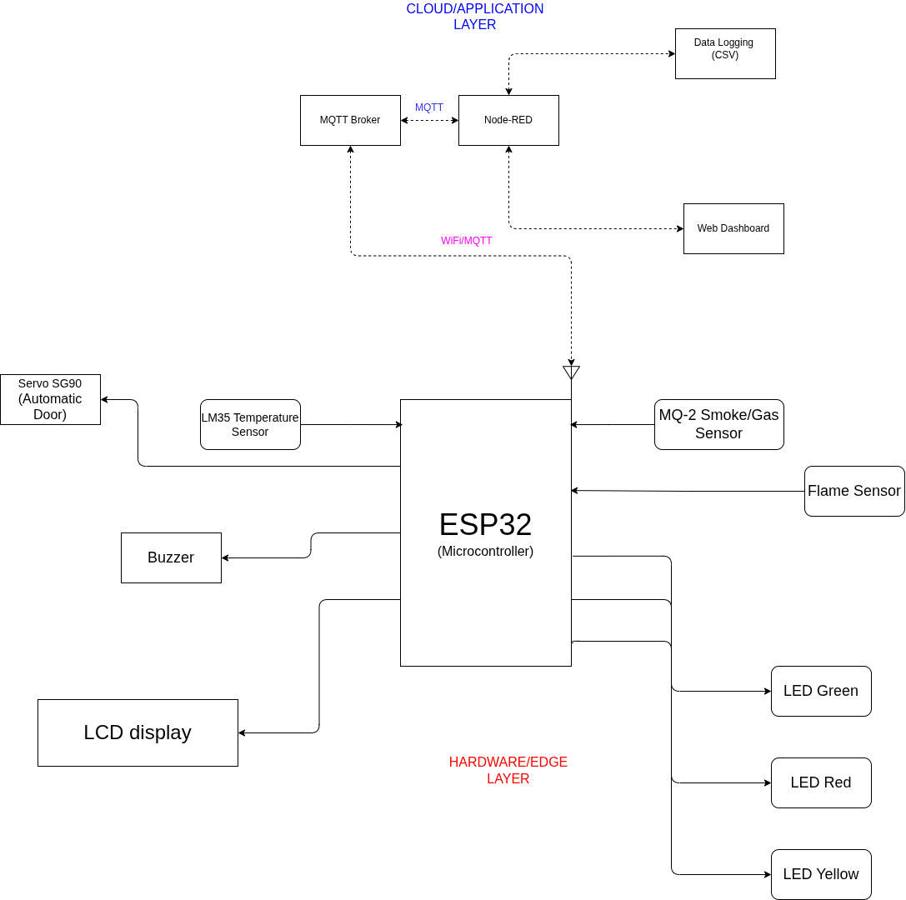
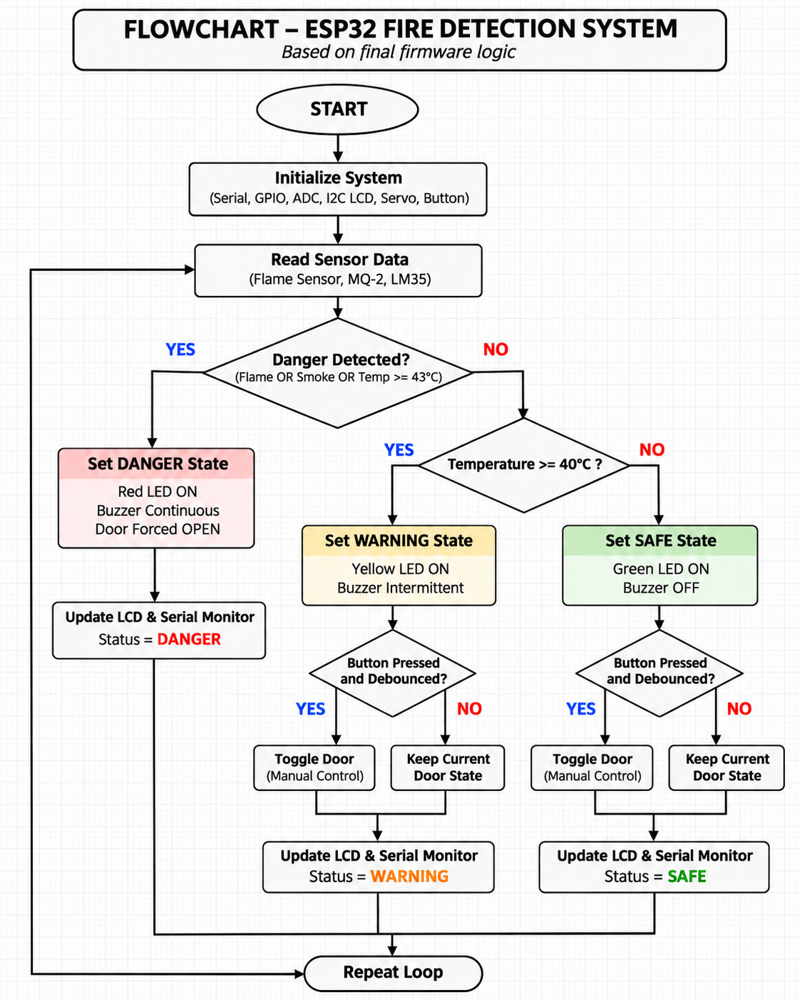

# IoT-Based Fire Detection and Warning System

**Final Project Report — IOT102, Fall 2026**  
**Class:** SE2027 · **Group:** G2 · **Instructor:** Nguyễn Đức Lợi  
**Institution:** FPT University, Ho Chi Minh City, Vietnam

| Member | Student ID | Primary responsibility | Contribution |
|---|---|---|---:|
| Hoang Nhat Tam | SE202018 | Project coordination, research, report | 33.33% |
| Phan Tan Hung | SE201027 | Firmware, sensor integration, debugging | 33.33% |
| Le Vo Tuan Kiet | SE203376 | Hardware assembly, circuit, prototype testing | 33.33% |

## Abstract

This report presents an ESP32-based fire detection and warning prototype integrating an LM35 temperature sensor, an MQ-2 smoke/gas module, and a flame sensor. A rule-based algorithm classifies conditions as SAFE, WARNING, or DANGER. Local feedback is provided by an LCD1602, three LEDs, and an active buzzer; an SG90 servo represents an automatic door, and a push button provides manual control outside DANGER. The team reported that all eight predefined functional cases passed, covering state selection and door behavior. These functional results are not a measurement of detection accuracy. The implemented firmware is entirely local and contains no Wi-Fi, cloud, dashboard, or machine-learning functionality.

**Keywords:** ESP32, fire detection, Internet of Things, LM35, MQ-2, multisensor warning, embedded systems.

## 1. Introduction and Related Work

Early recognition of temperature rise, flame, and smoke or gas can support timely local warning. A single detector or a fixed threshold may, however, respond to environmental interference. Yu *et al.* analyzed similarity among time-aligned detector signals [1], while Fathoni *et al.* used a radial-basis-function network with multiple fire and gas sensors [2]. Other published systems use a hierarchical decision tree on ESP32 [3], remote monitoring through Blynk and Telegram [4], gas-sensor-array calibration [5], recurrent trend prediction [6], or fuzzy-logic-based assessment [7].

The G2 prototype instead uses transparent fixed rules that run locally on an ESP32. This avoids a training dataset and reduces implementation complexity, but it cannot provide the discrimination of a validated data-driven model. The project objectives are to integrate three sensing modalities, implement three warning states, provide local visual and audible feedback, demonstrate automatic and manual model-door control, and verify these functions with predefined cases. Advanced methods and remote monitoring are future work only.

## 2. Methods and Materials

### 2.1. System Architecture

The sensing layer comprises the LM35, MQ-2 digital output, and flame-sensor digital output. The ESP32 performs local acquisition and rule evaluation. The output layer comprises an LCD1602, green/yellow/red LEDs, one active buzzer, and an SG90 servo. A push button is an additional input for manual door control.

Figure 1 also shows MQTT, Node-RED, CSV logging, and a web dashboard in a proposed cloud/application layer. None of those blocks is implemented by the final firmware; the solid hardware/edge layer is the implemented scope.

### 2.2. Hardware Components

The ESP32 DevKit supplies the processing, ADC, GPIO, I2C, and servo-control interfaces.

**Table 1. Main Hardware Components**

| Component | Function in the prototype |
|---|---|
| ESP32 DevKit | Local acquisition, classification, and output control |
| LM35 | Analog temperature sensing |
| MQ-2 module | Digital smoke/gas trigger |
| Flame module | Digital flame trigger |
| LCD1602 I2C | Sensor and state display |
| Three LEDs | SAFE, WARNING, and DANGER indication |
| Active buzzer | Intermittent or continuous audible warning |
| SG90 servo | Model-door actuation |
| Push button | Debounced manual door control |

### 2.3. Circuit Design and GPIO Mapping

Table 2 is transcribed from `src/FireDetectionSingleFinal.ino`, the source of truth for implemented pin assignments.

**Table 2. ESP32 GPIO Mapping in the Final Firmware**

| Device / signal | GPIO | Device / signal | GPIO |
|---|---:|---|---:|
| LM35 analog | 34 | Active buzzer | 15 |
| MQ-2 digital | 18 | Push button | 33 |
| Flame digital | 19 | SG90 signal | 32 |
| LCD SDA | 21 | Green LED | 25 |
| LCD SCL | 22 | Yellow LED | 26 |
|  |  | Red LED | 27 |

The team reports powering the ESP32 board from a 5 V input and powering the LM35 and active buzzer from the board’s 3.3 V rail. The reduced buzzer voltage was intentionally used to lower classroom demonstration volume. This report records the prototype configuration; it does not claim that the arrangement has been electrically validated. The exact LM35 variant, buzzer rating, 5 V module output levels, I2C pull-ups, servo supply capacity, and common-ground wiring must be checked against component specifications and physical wiring before reuse.

Figure 2 documents the intended interconnection and the final GPIO numbers. It remains a design artefact rather than proof of electrical compliance.

### 2.4. Sensor Data Processing

The sketch averages ten calls to `analogReadMilliVolts()`, separated by 5 ms delays, and computes:

$$T[^{\circ}\mathrm{C}] = \frac{\overline{V}_{\mathrm{LM35}}[\mathrm{mV}]}{10}.$$

This uses the LM35 nominal 10 mV/°C transfer factor. Averaging can reduce random variation but is not a substitute for calibration. Espressif documents ADC reference-voltage variation and calibration mechanisms [8]. The MQ-2 and flame modules are read only as active-LOW digital triggers; the firmware therefore does not estimate gas concentration or flame intensity.

### 2.5. Fire Detection Algorithm

Let $F$ denote the active flame input, $S$ the active MQ-2 input, and $T$ the estimated temperature. The highest-priority condition is:

$$D = F \lor S \lor (T \geq 43^{\circ}\mathrm{C}).$$

If $D$ is false, $40 \leq T < 43^{\circ}$C produces WARNING; otherwise the state is SAFE.

**Table 3. Warning States Implemented by the Firmware**

| State | Condition | Output behavior |
|---|---|---|
| SAFE | No flame/MQ-2 trigger and $T<40^{\circ}$C | Green LED; buzzer off |
| WARNING | No danger and $40\leq T<43^{\circ}$C | Yellow LED; buzzer 500 ms on/500 ms off |
| DANGER | Flame or MQ-2 trigger, or $T\geq43^{\circ}$C | Red LED; continuous buzzer; door commanded open |

In DANGER the servo is commanded to 90° and the button cannot close the door. Outside DANGER, a new active-LOW button press, validated with a 50 ms debounce interval under `INPUT_PULLUP`, toggles the servo between 0° and 90°. Clearing DANGER does not automatically close the door; the last door state persists until a valid manual press.

### 2.6. Software Implementation

Initialization configures 12-bit ADC operation, GPIO directions, a 100 kHz I2C bus on GPIO21/22, serial output at 115200 baud, and 50 Hz servo control. The firmware probes LCD addresses `0x27` and `0x3F`. Each loop reads the sensors, derives the state, updates door control, LEDs, buzzer, LCD, and serial output, and then delays 50 ms.

The code does **not** implement Wi-Fi, MQTT, Node-RED, Blynk, a database, CSV logging, a remote dashboard, or AI/ML classification.

## 3. Results and Discussion

### 3.1. Experimental Procedure and Functional Results

The group exercised eight predefined cases intended to check rule selection and door-control behavior. The team reported all eight as PASS. Table 4 records that confirmation; raw logs, repeated-trial counts, and measured response times were not supplied.

**Table 4. Team-Reported Functional Test Results**

| ID | Stimulus | Expected/observed behavior | Result |
|---|---|---|---|
| TC01 | Normal condition | SAFE | PASS |
| TC02 | $40\leq T<43^{\circ}$C; no digital trigger | WARNING | PASS |
| TC03 | $T\geq43^{\circ}$C | DANGER | PASS |
| TC04 | Flame input active | DANGER | PASS |
| TC05 | MQ-2 input active | DANGER | PASS |
| TC06 | Button pressed during DANGER | Door remains open | PASS |
| TC07 | DANGER condition removed | Door remains open | PASS |
| TC08 | Button pressed during SAFE | Door toggles | PASS |

The 8/8 result establishes agreement with these selected functional expectations only. It must not be interpreted as 100% fire-detection accuracy. Quantitative evaluation of response latency, LM35 error, false-positive rate, false-negative rate, and long-term reliability has not been performed or documented.

### 3.2. Prototype Demonstration

The assembled prototype integrates the sensors, indicators, LCD, buzzer, and model-door servo. A submission-quality physical-prototype photograph was not available in the repository during report preparation.

> **Figure 4 TODO — Physical prototype:** Insert an uncropped, readable photograph of the final wiring and model door. The LaTeX manuscript contains a clean, compilable placeholder and will automatically use `src/prototype.png` if that file is later added.

### 3.3. Discussion and Limitations

Local processing allows the alarm and door demonstration to operate without an Internet connection. The OR rule also reacts when any one danger indicator is active. Its simplicity is a trade-off: a transient digital trigger or non-fire smoke/gas source can cause DANGER, and there is no hysteresis near the temperature thresholds. Published multisensor fusion and temporal methods provide directions for reducing nuisance alarms [1, 5, 6], but the G2 prototype did not implement or evaluate them.

Further limitations are the lack of sensor calibration, quantitative test evidence, fault detection, power/logic-level validation, and safety certification. The SG90 actuates a classroom model and is not an emergency-door device. Accordingly, the prototype must not be represented or deployed as a certified fire-safety system.

## 4. Conclusion and Future Work

The project implements a local ESP32 prototype that combines LM35, MQ-2, and flame inputs with three warning states, an LCD, three LEDs, one buzzer, and model-door control. Firmware behavior and GPIO descriptions in this report are aligned with `src/FireDetectionSingleFinal.ino`. The team reported PASS for all eight predefined functional cases, while no statistical detection-performance claim is made.

Future work should first validate the physical schematic, power rails, logic levels, and sensor calibration, then collect timestamped repeated trials to quantify latency and false alarms. Hysteresis, sensor-fault handling, and evidence-based multisensor fusion can then be evaluated. Wi-Fi dashboards or Blynk may be added as optional monitoring extensions, but local warning behavior should remain independent of connectivity.

## Author Contributions

All members contributed approximately 33.33%. Hoang Nhat Tam (SE202018) handled project coordination, research, and report preparation. Phan Tan Hung (SE201027) handled firmware, sensor integration, and debugging. Le Vo Tuan Kiet (SE203376) handled hardware assembly, circuit work, and prototype testing. Final review and project decisions were shared by the group.

## References

1. M. Yu, H. Yuan, K. Li, and J. Wang, “Research on multi-detector real-time fire alarm technology based on signal similarity,” *Fire Safety Journal*, vol. 136, Art. no. 103724, 2023. doi: [10.1016/j.firesaf.2022.103724](https://doi.org/10.1016/j.firesaf.2022.103724).
2. K. Fathoni, A. F. Suni, N. Iksan, and M. S. Aziz, “Multisensor integration in early fire and gas detection based on artificial neural network,” *Edu Komputika Journal*, vol. 12, no. 2, pp. 157–167, 2025. doi: [10.15294/edukom.v12i2.27436](https://doi.org/10.15294/edukom.v12i2.27436).
3. J. Purba, D. Kiswanto, J. B. Henrydunan, and R. Dly, “Smart Safety Room: ESP32 decision tree-based multi-hazard detection system,” *Journal of Artificial Intelligence and Engineering Applications*, vol. 5, no. 2, pp. 2627–2637, 2026. doi: [10.59934/jaiea.v5i2.1947](https://doi.org/10.59934/jaiea.v5i2.1947).
4. N. Ramadani, “IoT-based early fire detection system using flame and gas sensors with Telegram Bot and Blynk Dashboard integration,” *Journal of Artificial Intelligence and Engineering Applications*, vol. 6, no. 1, pp. 603–612, 2026. doi: [10.59934/jaiea.v6i1.2805](https://doi.org/10.59934/jaiea.v6i1.2805).
5. A. Solórzano *et al.*, “Early fire detection based on gas sensor arrays: Multivariate calibration and validation,” *Sensors and Actuators B: Chemical*, vol. 352, Art. no. 130961, 2022. doi: [10.1016/j.snb.2021.130961](https://doi.org/10.1016/j.snb.2021.130961).
6. M. Nakip, C. Güzelis, and O. Yildiz, “Recurrent trend predictive neural network for multi-sensor fire detection,” *IEEE Access*, vol. 9, pp. 84204–84216, 2021. doi: [10.1109/ACCESS.2021.3087736](https://doi.org/10.1109/ACCESS.2021.3087736).
7. A. Rehman *et al.*, “Smart fire detection and deterrent system for human savior by using Internet of Things (IoT),” *Energies*, vol. 14, no. 17, Art. no. 5500, 2021. doi: [10.3390/en14175500](https://doi.org/10.3390/en14175500).
8. Espressif Systems, “Analog to Digital Converter (ADC) calibration driver,” *ESP-IDF Programming Guide*. [Online]. Available: <https://docs.espressif.com/projects/esp-idf/en/latest/esp32/api-reference/peripherals/adc/adc_calibration.html>. Accessed: Nov. 3, 2026.

## AI Usage Declaration

Generative AI, particularly ChatGPT by OpenAI, assisted literature exploration, technical explanations, design review, and academic writing. The team verified AI suggestions against the actual firmware, hardware documentation, and available functional-test results, and distinguished implemented features from proposed extensions. AI output was not accepted automatically. All final design decisions, implementation activities, observations, and conclusions remain the responsibility of the group members.

Selected verification and reflection records are maintained separately in the AI Audit Log. Blynk is an IoT platform and is not a generative-AI tool.
